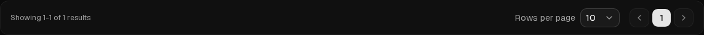

# SIGN-462 M07 pagination footer evidence

Captured by the focused fixture browser case in [`ai-provider-configs.spec.ts`](../../../../tests/e2e/ai-provider-configs.spec.ts) on the M07 AI Provider Config list.

- Viewport: 1440×1024 CSS pixels, dark theme, expanded sidebar.
- State: English locale, one fixture connection, one page; screenshot is footer-only.
- Computed styles: footer gap 16px; selector padding 8px on each side; navigation button gap 4px. Footer padding, label-selector and selector-navigation gaps, control/icon sizes, count placement and right-side alignment were also asserted.
- Keyboard: opened the page-size selector with Enter, closed it with Escape and verified focus returned to the selector.
- Responsive/accessibility: the same fixture case checks 360, 390, 767, 768, 1024, 1439, 1440, 1520 and 760 CSS-pixel viewports, page overflow, and axe critical/serious findings.

The accepted basis is [SIGN-450](https://signapse-group.atlassian.net/browse/SIGN-450), [SIGN-193-TC-01 M07](https://github.com/signapse-group/signapse-qa/blob/d861faee495220b1d4964f8f8d59fbd738dac024/test-cases/SIGN-193.md#sign-193-tc-01---shared-desktop-footer-placement-on-all-dashboard-screens), and the pinned [Pagination / Table design reference](https://github.com/signapse-group/signapse-planing/blob/8577b6fe34284a5d3adadaebba17bd2da114390b/ui-design/pen/references/dashboard-design-system.md#pagination--table).

This is local fixture evidence only. QA owns live UI/API and feature retesting after delivery; it does not establish product acceptance.

